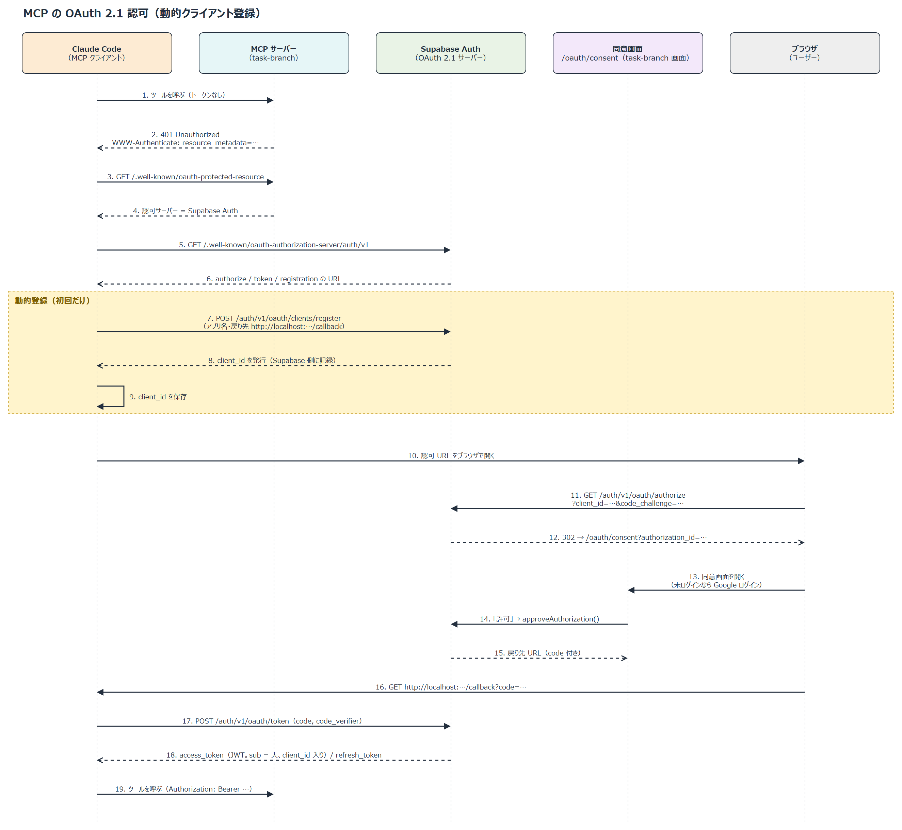

# task-branch 設計書 (DD)

AI がプランニングしたタスクを **粒度の異なる2階層のツリー** で管理し、タスクの **依存関係を DAG（ブランチ図）** として可視化するタスク管理アプリ。

- ステータス: Draft v0.3
- 作成日: 2026-09-15
- 対象: 個人利用（メンバーアサインなし）

## 目次

- [1. 目的とスコープ](#1-目的とスコープ)
  - [1.1 背景・狙い](#11-背景狙い)
  - [1.2 中核となる2つの関係（重要）](#12-中核となる2つの関係重要)
  - [1.3 2つの粒度（level）](#13-2つの粒度level)
  - [1.4 満たすべき要件](#14-満たすべき要件)
  - [1.5 スコープの段階（初期 / 将来）](#15-スコープの段階初期--将来)
- [2. アーキテクチャ](#2-アーキテクチャ)
  - [2.1 技術スタック（推奨）](#21-技術スタック推奨)
- [3. データモデル](#3-データモデル)
  - [3.1 ER 概要](#31-er-概要)
  - [3.2 テーブル定義](#32-テーブル定義)
  - [3.3 派生概念（計算で導出）](#33-派生概念計算で導出)
  - [3.4 進捗の集約（ロールアップ）](#34-進捗の集約ロールアップ)
  - [3.5 RLS ポリシー](#35-rls-ポリシー)
- [4. API 設計（AI / フロント共通）](#4-api-設計ai--フロント共通)
  - [4.1 CRUD（PostgREST 自動生成）](#41-crudpostgrest-自動生成)
  - [4.2 RPC 関数（ロジックを DB に集約）](#42-rpc-関数ロジックを-db-に集約)
  - [4.3 `planning` / `do` スキルの動作イメージ](#43-planning--do-スキルの動作イメージ)
- [5. 可視化 UI 設計](#5-可視化-ui-設計)
  - [5.1 画面構成](#51-画面構成)
  - [5.2 表現](#52-表現)
  - [5.3 レイアウト](#53-レイアウト)
  - [5.4 ビュー層のアーキテクチャ（拡張性の要）](#54-ビュー層のアーキテクチャ拡張性の要)
- [6. ローカル開発 → 本番](#6-ローカル開発--本番)
  - [6.1 ローカル（初期）](#61-ローカル初期)
  - [6.2 本番（将来）](#62-本番将来)
  - [6.3 リポジトリ構成（予定）](#63-リポジトリ構成予定)
- [7. セキュリティ（個人用の割り切り）](#7-セキュリティ個人用の割り切り)
  - [7.1 AI のトークン](#71-ai-のトークン)
  - [7.2 MCP の OAuth 2.1 認可（動的クライアント登録）](#72-mcp-の-oauth-21-認可動的クライアント登録)
- [8. 拡張性設計（将来ビュー: ガント / カレンダー / カンバン）](#8-拡張性設計将来ビュー-ガント--カレンダー--カンバン)
  - [8.1 各ビューが必要とするもの](#81-各ビューが必要とするもの)
  - [8.2 拡張ポイントと方針](#82-拡張ポイントと方針)
  - [8.3 破壊的変更を避ける原則](#83-破壊的変更を避ける原則)
- [9. 未決事項 / 要確認](#9-未決事項--要確認)
- [10. 次のステップ](#10-次のステップ)

---

## 1. 目的とスコープ

### 1.1 背景・狙い

AI（Claude Code の `planning` スキル）が今後のタスクを洗い出し・優先順位付けし、その結果を構造化データとして蓄積・可視化する。実装と進捗の更新は `do` スキルが行う。どちらのスキルもリポジトリの外（`~/.claude/skills/`）に置き、今は task-branch の画面を操作して読み書きする（§4.3）。人間はブラウザで進捗・階層構造・依存関係（枝分かれ）・クリティカルパスを確認する。

### 1.2 中核となる2つの関係（重要）

本アプリのデータは **直交する2種類の関係** を同時に持つ。

| 関係             | 形     | 何を表すか                         | 例                                                                               |
| ---------------- | ------ | ---------------------------------- | -------------------------------------------------------------------------------- |
| **階層（分解）** | ツリー | 粒度の粗いオブジェクトを細かく分解 | 「認証移行(story/1週)」→「テストケース作成(task)」                             |
| **依存（順序）** | DAG    | 「Aが終わってからB」という実行順序 | 「OAuth クライアント作成」→「Supabase 設定」→「ログイン画面作成」                |

- 階層は **`parent_id` によるツリー**。
- 依存のデータの持ち方（テーブル・検証・RPC）は未設計。クリティカルパス・並列レーン・着手可能の判定を実装するときに設計する。

### 1.3 2つの粒度（level）

`story > task` の順にネストする（2段）。以前は `epic > story > task` の3段だったが、個人の開発では段が多いため2段にした（§9 Q4。移行の記録は §1.3.1）。

| 観点                       | ストーリー（`story`）                                                                                                                                         | タスク（`task`）                                                                                              |
| -------------------------- | ------------------------------------------------------------------------------------------------------------------------------------------------------------- | ------------------------------------------------------------------------------------------------------------- |
| 粒度                       | 1つのコンテキスト。1〜2週間（1スプリント）で完了させる                                                                                                       | 数時間                                                                                                        |
| 役割                       | 課題・問題点・改善点などの**コンテキスト（要件）**を持ち、タスクを洗い出す元になる                                                                           | ストーリーをさらに細分化した作業                                                                              |
| 作り方                     | 人が作るか、AI と壁打ちしながら作る。壁打ちの結論はドキュメント（`context`）に書く                                                                           | ストーリーから洗い出す                                                                                        |
| 状態                       | 着手状態（`activated_at`。null ＝ バックログ）と、`todo` / `in_progress` / `done` / `closed`（`status`）の2つの軸を持つ。完了は `status` を手で動かす（§9 Q11）        | `todo` / `in_progress` / `done` / `closed` を手で動かす                                                       |
| 管理のしかた               | スプリントごとの振り返り、日々の進捗確認                                                                                                                      | 日々の進捗確認                                                                                                |
| 情報の持ち方               | **短い説明**（`description`）＋ **ドキュメント**（`context`、Markdown。正の情報）。ドキュメントは更新履歴を持つ                                               | 短い説明（`description`）＋ コメント                                                                          |
| 依存関係・クリティカルパス | 持たない（ストーリー間の順序は §9 Q2）                                                                                                                        | 前提タスク → 後続タスク。張れるのは**同じストーリー内のタスク間**だけ。クリティカルパスはストーリー内で求める |
| 担当                       | 持たない                                                                                                                                                      | 人か AI か。人の場合は誰か                                                                                    |
| 見える場所                 | バックログ：バックログの一覧だけ／着手後：ガントチャート・カンバン・マップ。カンバンには `status` が `in_progress` のものを出す（§9 Q11）                     | 親のストーリーと同じ                                                                                          |

- 着手してからタスクへ分解する。細分化を着手の直前まで遅らせることで、計画が古くなるのを防ぐ。

#### 1.3.1 2段への移行（3段階。完了）

main へのマージでマイグレーションと画面が同時に本番へデプロイされるため、旧画面を壊さない順に3段階で入れる。

| 段階 | 入れるもの                                                                                                                                          | 旧画面                       |
| ---- | --------------------------------------------------------------------------------------------------------------------------------------------------- | ---------------------------- |
| ①    | ストーリーにコンテキスト・着手日時（`activated_at`）・更新履歴を持てるようにする（`0015_story_context.sql`）                                       | そのまま動く                 |
| ②    | エピックのデータをストーリーへ複製するマイグレーションと、画面（バックログ・ストーリー詳細・ガント・カンバン・詳細パネル）の切り替えを同じリリースで入れる | 2段の画面に切り替わる        |
| ③    | ストーリーがないエピックをストーリーに変換し、残りのエピックを削除する。`level`・制約・トリガ・RPC・履歴テーブル名・サンプルデータを2段に揃える（`0019_drop_epic_level.sql`） | —                            |

- エピックのコンテキストは配下の全ストーリーに複製する。更新履歴は最新版だけを各ストーリーの v1 として持ち越す。
- エピック名は捨てる（ストーリー名に付けない、ラベル列も作らない）。
- 配下にストーリーがないエピックは、そのままストーリーに変換する（名前・説明・コンテキスト・`activated_at` を残す）。
- 複製を②に置くのは、①と②の間に旧画面でエピックのコンテキストを編集すると複製とずれるため。
- 更新履歴のテーブルは、①②の間は既存の `epic_context_revisions` をそのまま使い、③で `story_context_revisions`（列 `story_id`）に付け替えた。
- ③では、ストーリーの `sort_order` をプロジェクトごとに、エピックがあったときの並び（エピック順 → エピック内の順、親なしは最後）で 1 から振り直した。

### 1.4 満たすべき要件

| #   | 要件                                    | 対応方針                                                                                                     |
| --- | --------------------------------------- | ------------------------------------------------------------------------------------------------------------ |
| R1  | AI がプランニングしたタスクを管理       | `planning` スキルが画面を操作して登録（将来は MCP サーバー経由で REST/RPC）                                  |
| R2  | 並列度を上げたい                        | 依存のない `task` を並列レーンに。着手可能かどうか（前提タスクがすべて `done` か `closed` か）は依存から導出 |
| R3  | 終わった / これから進めるタスクを見れる | status フィルタ・ビュー                                                                                      |
| R4  | マインドマップ / Git ブランチ状に可視化 | 階層ツリー + タスクの依存DAG（ブランチ図）                                                                   |
| R5  | 依存は直列、非依存は並列で配置          | トポロジカル順で rank 配置。前後関係は横、同 rank（並列）は縦に並べる                                        |
| R6  | クリティカルパスがわかる                | タスクの依存チェーンの **最長経路（ホップ数, 重み1）** を強調                                                |
| R7  | プロジェクト単位で管理                  | `projects` でスコープ分離                                                                                    |
| R8  | 誰がやるかを管理                        | タスクに担当（人 / AI、人の場合は誰か）を持たせる                                                            |
| R9  | 安価・最速                              | Supabase（無料枠）+ 自動生成 API。専用バックエンドを作らない                                                 |
| R10 | どこからでも編集可能                    | Supabase Cloud にホスト（初期はローカル Supabase で開発）                                                    |

### 1.5 スコープの段階（初期 / 将来）

**初期（Phase 1）で作るビュー**: 階層ツリー / ブランチ図(DAG) / リスト / クリティカルパス。

**将来ビュー（設計上あらかじめ拡張可能にしておく）**: ガントチャート / カレンダー / カンバン（§10 参照）。
これらは **コアモデルへの読み取りビュー（射影）として追加**でき、スキーマの破壊的変更を伴わない。

**当面の非スコープ**:

- 見積り時間 / 工数（`estimate` は将来拡張。初期は持たない → CP はホップ数で算出）
- 権限・コラボ機能の詳細（担当として人を割り当てることは行う。ユーザー登録・共有の範囲は §9）
- 外部カレンダー（Google Calendar 等）双方向同期

---

## 2. アーキテクチャ

```
┌─────────────────────────────┐
│  Claude Code                 │  planning スキル: 計画を登録 / do スキル: 実装・進捗の更新
│  planning / do スキル         │
└───────────────┬─────────────┘
                │ Playwright MCP で画面を操作（将来は MCP サーバー経由で REST / RPC）
                ▼
┌─────────────────────────────┐
│  Web UI (React + Vite)       │  階層ツリー・ブランチ図・CP・進捗
│  └─ React Flow + dagre       │
└───────────────┬─────────────┘
                │ supabase-js
                ▼
┌─────────────────────────────┐
│  Supabase                    │
│  ├─ PostgREST (自動REST API) │  ← CRUD の主経路
│  ├─ RPC 関数 (Postgres)      │  ← グラフ取得 / 進捗集約 / エクスポート
│  ├─ Postgres (データ本体)     │
│  └─ Auth (APIキー / 将来JWT)  │
└─────────────────────────────┘
```

- **バックエンドは自作しない**。Supabase が REST API・認証・ホスティングを提供。
- 複雑なロジック（循環検出・クリティカルパス・進捗集約）は **Postgres 関数（RPC）** に集約し、AI・フロント双方から同じ関数を呼ぶ。
- ローカル開発は `supabase start`（Docker）。本番は同一マイグレーションを Supabase Cloud に `db push`。

### 2.1 技術スタック（推奨）

| 層               | 技術                                        | 理由                                         |
| ---------------- | ------------------------------------------- | -------------------------------------------- |
| DB / API / 認証  | Supabase (Postgres 15 + PostgREST + GoTrue) | 無料枠、自動 REST、ローカル↔クラウド同一構成 |
| マイグレーション | Supabase CLI (`supabase/migrations`)        | 再現可能なスキーマ管理                       |
| フロント         | React 18 + TypeScript + Vite                | 軽量・高速・無料デプロイ可                   |
| グラフ描画       | React Flow + dagre                          | 階層ツリー / DAG / CP 強調に最適             |
| Supabase 接続    | `@supabase/supabase-js`                     | 標準クライアント                             |
| デプロイ(将来)   | Vercel / Cloudflare Pages + Supabase Cloud  | 無料枠                                       |

---

## 3. データモデル

### 3.1 ER 概要

```
所有者（ユーザー） 1 ──< projects
projects 1 ──< tasks(自己参照ツリー parent_id)
projects 1 ──< story_groups 1 ──< tasks(story のみ。group_id)
                 ├──< story_context_revisions (story のドキュメントの更新履歴)
                 ├──< task_comments (task へのコメント。本文は編集できる)
                 └──> 担当者（人の場合。ユーザー）
```

- `tasks` 1テーブルで2階層すべてを表現し、`level` と `parent_id` で区別する。

### 3.2 テーブル定義

#### projects

| カラム      | 型          | 制約                                                   | 説明                                                                              |
| ----------- | ----------- | ------------------------------------------------------ | --------------------------------------------------------------------------------- |
| id          | uuid        | PK, default gen_random_uuid()                          |                                                                                   |
| name        | text        | not null                                               | プロジェクト名                                                                    |
| description | text        |                                                        | 概要                                                                              |
| owner_id    | uuid        | FK→auth.users.id, not null, default current_owner_id() | 所有者（人のユーザー）。AI が作っても持ち主の人になる。付け替えはできない（§3.5） |
| created_at  | timestamptz | default now()                                          |                                                                                   |
| updated_at  | timestamptz | default now()                                          |                                                                                   |

- インデックス：(owner_id)。
- 所有者の列を持つのは projects だけ。tasks・task_comments・story_context_revisions は、属するプロジェクトの所有者をたどって判定する（§3.5）。

#### tasks

| カラム        | 型          | 制約                          | 説明                                                                                                                                                                                                                                                                                                                 |
| ------------- | ----------- | ----------------------------- | -------------------------------------------------------------------------------------------------------------------------------------------------------------------------------------------------------------------------------------------------------------------------------------------------------------------- |
| id            | uuid        | PK, default gen_random_uuid() |                                                                                                                                                                                                                                                                                                                      |
| project_id    | uuid        | FK→projects.id, not null      |                                                                                                                                                                                                                                                                                                                      |
| parent_id     | uuid        | FK→tasks.id, null可           | 親（階層）。story は null（ルート）、task は親の story                                                                                                                                                                                                                                                                                |
| group_id      | uuid        | FK→story_groups.id, null可, on delete set null | **story のみ**。属するグループ（ガントチャートでまとめて見せる単位）。null はグループなし。グループを消すとグループなしに戻る                                                                                                                                                                                |
| level         | text        | not null                      | `story` / `task`                                                                                                                                                                                                                                                                                                     |
| title         | text        | not null                      | 名称                                                                                                                                                                                                                                                                                                                 |
| description   | text        |                               | 短い説明（一覧やカードに出す 1〜2 行）                                                                                                                                                                                                                                                                               |
| context       | text        | null可                        | **story のみ**。ドキュメント（Markdown）。壁打ちの結論をまとめた**正の情報**。見出しの型：背景・課題／ゴール／スコープと非スコープ／方針／決定事項／未決事項。保存のたびにその版を `story_context_revisions` に残す（最新版も含む）                                                                                    |
| status        | text        | not null, default 'todo'      | `todo` / `in_progress` / `done` / `closed`（作業の進み具合）。`done` は終わったが未承認（カンバンに残し、デイリースクラムで報告する）、`closed` は承認を得て管理から外したもの（カンバンの列には出さず、トグルでのみ表示）。進捗では `done` と `closed` をどちらも完了として数える |
| activated_at  | timestamptz | null可                        | **story のみ**。null ＝ バックログ、日時あり ＝ 着手済み。着手した日時を兼ねる。進み具合の `status` とは別の軸なので列を分ける                                                                                                     |
| assignee_type | text        | null可                        | **task のみ**。`human`（人）/ `ai`（AI）。既定値は §9                                                                                                                                                                                                                                                                |
| assignee_id   | uuid        | null可                        | **task のみ**。人が担当する場合の担当者（ユーザー）                                                                                                                                                                                                                                                                  |
| sort_order    | int         | not null, default 0           | 同階層内 / カンバン列内の表示順                                                                                                                                                                                                                                                                                      |
| start_date    | date        | null可                        | 開始予定日（**ガント/カレンダー用**。初期は未使用）                                                                                                                                                                                                                                                                  |
| due_date      | date        | null可                        | 期限日（**ガント/カレンダー用**。初期は未使用）                                                                                                                                                                                                                                                                      |
| metadata      | jsonb       | not null, default '{}'        | 将来拡張用の自由属性（色・タグ・外部ID等）。スキーマ変更なしで拡張                                                                                                                                                                                                                                                   |
| created_at    | timestamptz | default now()                 |                                                                                                                                                                                                                                                                                                                      |
| updated_at    | timestamptz | default now()                 |                                                                                                                                                                                                                                                                                                                      |
| completed_at  | timestamptz |                               | done 遷移時刻。`done` / `closed` の間は保持する                                                                                                                                                                                                                                                                      |
| closed_at     | timestamptz |                               | closed 遷移時刻（承認した日時）。`closed` 以外では null                                                                                                                                                                                                                                                              |

制約・ルール:

- `level` は CHECK で2値に固定。
- 階層整合性は **トリガ**（`check_task_hierarchy()`）で担保。`story` はルート（親なし）だけに置ける。`task` の親は同じプロジェクトの `story` だけ。
- `task` は葉。子を持たない。
- 親の進捗は子から集約（§3.4）。
- **拡張フィールド（`start_date` / `due_date` / `metadata`）は nullable で初期は未使用**。ガント/カレンダー等のビュー追加時にそのまま利用でき、既存機能に影響しない。
- 見積り（`estimate`）は未導入。導入時は `estimate_value numeric` + `estimate_unit text` を追加する想定（§10）。
- `context` は長文になるため、一覧系の取得（カンバン・ガントチャート・`get_task_graph` など）では読み込まない。詳細・バックログの画面と、AI にストーリーの文脈を渡すときだけ取得する。
- `group_id` を持てるのは `level = 'story'` の行だけで、グループはストーリーと同じプロジェクトに属すること（トリガ `check_task_group()`）。

#### story_groups

ストーリーのグループ。ガントチャートでストーリーをまとめて見せるための入れ物。

| カラム     | 型          | 制約                                                | 説明                     |
| ---------- | ----------- | --------------------------------------------------- | ------------------------ |
| id         | uuid        | PK, default gen_random_uuid()                       |                          |
| project_id | uuid        | FK→projects.id, not null, on delete cascade         | 属するプロジェクト       |
| name       | text        | not null, check (length(btrim(name)) > 0)           | グループ名               |
| sort_order | int         | not null, default 0                                 | プロジェクト内の表示順   |
| created_at | timestamptz | not null, default now()                             |                          |
| updated_at | timestamptz | not null, default now()                             | 更新時に now()（トリガ） |

- インデックス：(project_id, sort_order)。
- 状態・期間・コンテキストは持たない。期間は中のストーリーから画面で算出する。
- `project_id` は付け替えられない（トリガ `check_story_group()`。中のストーリーとプロジェクトがずれるため）。
- `get_task_graph` は nodes に `group_id` を含め、`groups`（id / name / sort_order）を返す。
- RLS は §3.5。

#### task_comments

タスクへのコメント。作業メモ・確認したこと・やりとりを残す。

| カラム      | 型          | 制約                                      | 説明                       |
| ----------- | ----------- | ----------------------------------------- | -------------------------- |
| id          | uuid        | PK, default gen_random_uuid()             |                            |
| task_id     | uuid        | FK→tasks.id, not null, on delete cascade  | 対象のタスク（level=task） |
| author_type | text        | not null, default current_actor_type()    | `human` / `ai`             |
| author_id   | uuid        | null可, default current_actor_id()        | 投稿者（ユーザー）         |
| body        | text        | not null, check (length(btrim(body)) > 0) | 本文（プレーンテキスト）   |
| created_at  | timestamptz | not null, default now()                   |                            |
| updated_at  | timestamptz | not null, default now()                   |                            |

- インデックス：(task_id, created_at)。
- 対象は `level = 'task'` のみ。ストーリーには付けられない（トリガ `check_task_comment()` で弾く）。
- 編集・削除できるのは、書いた本人だけ（§3.5）。人と AI は別の投稿者として扱い、人も AI のコメントは編集・削除できない。変えられるのは本文だけで、`task_id` / `author_type` / `author_id` / `created_at` は変えさせない。更新時に `updated_at` を now() にする。
- 削除は物理削除。編集履歴は持たない。
- 本文はプレーンテキスト（Markdown は解釈しない）。
- RLS は §3.5。

#### story_context_revisions

ストーリーのドキュメント（`context`）の更新履歴。差分の確認と巻き戻しに使う。移行の段階③で `epic_context_revisions` から名前を付け替えた（§1.3.1）。

| カラム         | 型          | 制約                          | 説明                            |
| -------------- | ----------- | ----------------------------- | ------------------------------- |
| id             | uuid        | PK, default gen_random_uuid() |                                 |
| story_id       | uuid        | FK→tasks.id, not null         | 対象のストーリー                |
| version        | int         | not null                      | 版番号（対象ごとに 1 から）     |
| context        | text        | not null                      | その版の本文                    |
| edited_by_type | text        | not null                      | `human` / `ai`                  |
| edited_by_id   | uuid        | null可                        | 人の場合の更新者                |
| created_at     | timestamptz | default now()                 |                                 |

- UNIQUE(story_id, version)。
- `tasks.context` を保存するたびに、トリガでその版を保存する（最新版も含む。人・AI どちらの更新でも漏れなく残す）。
- 人か AI かは、リクエストの JWT の `client_id`（あれば AI）で判定する（`current_actor_type()`、§3.5）。認証が無い場合や psql からの更新は人として扱う。コメントの `author_type` / `author_id` も同じ関数を既定値にする。

### 3.3 派生概念（計算で導出）

いずれも依存から導出する。依存のデータの持ち方は未設計で、実装時に設計する（§1.2）。

- **rank（列／並列レーン）**: ストーリー内で前提タスクのない task を rank 0 とし、`rank(t)=max(rank(前提))+1`。同 rank のタスクは並列に進められる（R5）。
- **クリティカルパス**: ストーリー内のタスク依存 DAG の **最長経路（各 task の重み=1、ホップ数）**（R6）。将来 `estimate` 追加時は重み付き最長経路へ拡張。
- **着手可能**: 前提タスクがすべて `done` か `closed` の task。status としては持たず、依存から導出する（R2）。

### 3.4 進捗の集約（ロールアップ）

- `task` の完了数 / 総数 → 親 `story` の進捗率。完了数は `done` と `closed` の合計（クローズしても進捗が下がらないように）。
- task が1件もない `story` は、自身の status が `done` か `closed` なら 1、それ以外は 0。
- 集約は RPC / ビューで計算し、UI に返す。ストーリー・タスクの手動 status 変更は許容。

### 3.5 RLS ポリシー

本人と本人の AI だけがデータに触れるようにする。人か AI か・誰のデータかは、リクエストの JWT から判定する。

#### JWT 形式

`app_metadata` は Supabase Auth が JWT に自動で入れる項目（実体は `auth.users.raw_app_meta_data`）。`provider` / `providers` は Supabase が入れる。こちらからは何も足さない。
本人が書き換えられる `user_metadata` は権限の判定に使わない。

AI は AI 専用アカウントを持たず、人が自分のアカウントで OAuth 2.1 の同意をして得たトークンを使う（§7.1）。そのため `sub` は人と同じで、AI のトークンにだけ `client_id`（Supabase が動的登録で発行したクライアントの id）が入る。

人（Google でログイン。uid = `aaaa`）:

```json
{
  "sub": "aaaa",
  "role": "authenticated",
  "app_metadata": { "provider": "google", "providers": ["google"] }
}
```

AI（`aaaa` が Claude Code に同意して得た OAuth のトークン。client_id = `kkkk`）:

```json
{
  "sub": "aaaa",
  "role": "authenticated",
  "aud": "authenticated",
  "client_id": "kkkk",
  "app_metadata": { "provider": "google", "providers": ["google"] }
}
```

- ヘッダの `alg` はどちらも `ES256`（§7.1）。
- AI のトークンの `app_metadata` は人と同じ。`actor_type` / `owner_id` は入らない。

#### 関数

PostgREST は、リクエストの JWT の中身を `request.jwt.claims` にセットしてから SQL を実行する。下の関数とポリシーはこれを読む。

列の既定値とポリシーから呼ぶ。どれも JWT を読むだけで、表は読まない。アプリからは呼ばない。

| 関数                   | 返すもの                                                                                                          | 使う場所                                                                      |
| ---------------------- | ----------------------------------------------------------------------------------------------------------------- | ----------------------------------------------------------------------------- |
| `current_actor_type()` | `ai`（JWT に `client_id` がある）／ それ以外は `human`                                                            | `task_comments.author_type`・`story_context_revisions.edited_by_type` の既定値 |
| `current_actor_id()`   | JWT の `sub`（`auth.uid()` と同じ）。JWT が無ければ null                                                          | `task_comments.author_id`・`story_context_revisions.edited_by_id` の既定値     |
| `current_owner_id()`   | 実効の所有者。JWT の `app_metadata.owner_id` があればそれ、無ければ `auth.uid()`。人も AI も本人になる           | `projects.owner_id` の既定値、ポリシー                                        |

```sql
create or replace function current_actor_type() returns text as $$
  select case
    when nullif(
           coalesce(nullif(current_setting('request.jwt.claims', true), ''), '{}')::jsonb ->> 'client_id', ''
         ) is not null then 'ai'
    else 'human'
  end;
$$ language sql stable;

create or replace function current_owner_id() returns uuid as $$
  select coalesce(
    (auth.jwt() -> 'app_metadata' ->> 'owner_id')::uuid,  -- 今は使わない（入れる経路が無い）
    auth.uid()                                              -- 人も AI も自分の id
  );
$$ language sql stable;
```

上の JWT での結果:

| 関数                   | 人                                           | AI                                           | JWT なし（psql・シード） |
| ---------------------- | -------------------------------------------- | -------------------------------------------- | ------------------------ |
| `current_actor_type()` | `human`                                      | `ai`（`client_id` がある）                   | `human`                  |
| `current_actor_id()`   | `aaaa`                                       | `aaaa`                                       | null                     |
| `auth.uid()`           | `aaaa`                                       | `aaaa`                                       | null                     |
| `current_owner_id()`   | `aaaa`（`owner_id` が無いので `auth.uid()`） | `aaaa`（`owner_id` が無いので `auth.uid()`） | null                     |

- 所有者の決め方は `current_owner_id()` 1か所にまとめる。ポリシーには同じ式を書かない。
- `current_owner_id()` は人と AI で同じ値になる。所有者の判定に使う。
- `auth.uid()` / `current_actor_id()` も人と AI で同じ値になる。投稿者の判定は `author_id`（`edited_by_id`）と `author_type`（`edited_by_type`）の組で行う。
- `current_owner_id()` の `app_metadata.owner_id` の分岐は今は使わない（AI 専用アカウントを作らないため、入れる経路が無い）。`app_metadata` は service_role でしか書けないため、利用者が `owner_id` を書き換えて他人のデータに入ることはできない。
- どれも security invoker（既定）。security definer にはしない。
- JWT なしは postgres ロールでの接続で、RLS を受けない。`projects.owner_id` の既定値が null になるため、psql やシードでプロジェクトを作るときは `owner_id` を明示する。

#### RLS ポリシー

全テーブルで RLS を有効にする。ポリシーはすべて `to authenticated` に対して作り、`anon` 向けは作らない（未ログインでは何もできない）。
ポリシーを作らない操作は RLS で拒否される。画面に機能が無くても API（PostgREST）から直接呼べるため、させない操作はポリシーを作らないことで止める。

| テーブル               | insert                                          | select | update                              | delete     |
| ---------------------- | ----------------------------------------------- | ------ | ----------------------------------- | ---------- |
| projects               | ログイン済みなら誰でも。`owner_id` は自分に固定 | 所有者 | 所有者。`owner_id` の付け替えは不可 | 所有者     |
| tasks                  | 所有者                                          | 所有者 | 所有者                              | 所有者     |
| story_groups           | 所有者                                          | 所有者 | 所有者                              | 所有者     |
| story_context_revisions | 所有者                                         | 所有者 | 不可                                | 不可       |
| task_comments          | 所有者                                          | 所有者 | 書いた本人                          | 書いた本人 |

- 「所有者」は、行が属するプロジェクトの `owner_id = current_owner_id()`。人なら本人、AI なら持ち主の人のプロジェクトが対象になる（本人と本人の AI が同じ範囲を触れる）。
- 「書いた本人」は `author_id = auth.uid() and author_type = current_actor_type()`。人と AI は uid が同じなので、種別も合わせて別の投稿者として扱う（AI は人のコメントを、人は AI のコメントを編集・削除できない）。
- 「不可」はポリシーを作らない。

ポリシー定義:

##### projects

所有者だけが読み書きできる。どの操作も条件が同じなので `for all` の1本にする。`with check` にも同じ条件を書き、他人名義での作成と所有者の付け替えを弾く。

```sql
alter table projects enable row level security;

create policy projects_owner on projects
  for all to authenticated
  using      (owner_id = current_owner_id())
  with check (owner_id = current_owner_id());
```

##### tasks

属するプロジェクトの所有者だけが読み書きできる。`with check` にも書き、他人のプロジェクトへの作成・移動を弾く。

```sql
alter table tasks enable row level security;

create policy tasks_owner on tasks
  for all to authenticated
  using (exists (
    select 1 from projects p
     where p.id = tasks.project_id
       and p.owner_id = current_owner_id()
  ))
  with check (exists (
    select 1 from projects p
     where p.id = tasks.project_id
       and p.owner_id = current_owner_id()
  ));
```

##### story_groups

tasks と同じく、属するプロジェクトの所有者だけが読み書きできる。

```sql
alter table story_groups enable row level security;

create policy story_groups_owner on story_groups
  for all to authenticated
  using (exists (
    select 1 from projects p
     where p.id = story_groups.project_id
       and p.owner_id = current_owner_id()
  ))
  with check (exists (
    select 1 from projects p
     where p.id = story_groups.project_id
       and p.owner_id = current_owner_id()
  ));
```

##### story_context_revisions

ストーリー → プロジェクトをたどって所有者だけが読み、足せる。足すときは更新者が自分であることも確かめる（トリガが入れる値と一致する）。update / delete はポリシーを作らない。

```sql
alter table story_context_revisions enable row level security;

create policy story_context_revisions_select on story_context_revisions
  for select to authenticated
  using (exists (
    select 1 from tasks t
      join projects p on p.id = t.project_id
     where t.id = story_context_revisions.story_id
       and p.owner_id = current_owner_id()
  ));

create policy story_context_revisions_insert on story_context_revisions
  for insert to authenticated
  with check (
    edited_by_id = auth.uid()
    and edited_by_type = current_actor_type()
    and exists (
      select 1 from tasks t
        join projects p on p.id = t.project_id
       where t.id = story_context_revisions.story_id
         and p.owner_id = current_owner_id()
    )
  );
```

##### task_comments

タスク → プロジェクトをたどって所有者だけが読み、投稿できる。投稿は投稿者が自分であることも確かめ、なりすましを弾く。編集・削除は書いた本人（uid と種別が一致する）だけ。

```sql
alter table task_comments enable row level security;

create policy task_comments_select on task_comments
  for select to authenticated
  using (exists (
    select 1 from tasks t
      join projects p on p.id = t.project_id
     where t.id = task_comments.task_id
       and p.owner_id = current_owner_id()
  ));

create policy task_comments_insert on task_comments
  for insert to authenticated
  with check (
    author_id = auth.uid()
    and author_type = current_actor_type()
    and exists (
      select 1 from tasks t
        join projects p on p.id = t.project_id
       where t.id = task_comments.task_id
         and p.owner_id = current_owner_id()
    )
  );

create policy task_comments_update on task_comments
  for update to authenticated
  using      (author_id = auth.uid() and author_type = current_actor_type())
  with check (author_id = auth.uid() and author_type = current_actor_type());

create policy task_comments_delete on task_comments
  for delete to authenticated
  using (author_id = auth.uid() and author_type = current_actor_type());
```

- `story_context_revisions` の insert は、ストーリーの `context` の保存時にトリガ（`save_story_context_revision()`）が利用者の権限で行う。そのため insert のポリシーが要る。
- RPC（`get_progress` / `get_task_graph` / `export_project`）とトリガは security invoker のままにし、RLS の下で動かす。ビューを作るときは `security_invoker = true` にする。
- `current_actor_type()` の `client_id` 判定と、task_comments の update / delete で種別も見る条件は `0014_actor_type_oauth_client.sql` で入れた（それまでは `app_metadata.actor_type` で判定し、update / delete は `author_id` だけを見ていた）。
- `parent_id` に他人のタスクを指定することは、トリガ `check_task_hierarchy()` が「親は同じプロジェクト」を確かめるため起きない。
- 既存の projects の `owner_id` はマイグレーションでは埋めず、本番で手動の update で埋める（利用者の uid をリポジトリに残さないため）。埋めたあと、`0013_projects_owner_not_null.sql` で `not null` を付けた。

---

## 4. API 設計（AI / フロント共通）

### 4.1 CRUD（PostgREST 自動生成）

| 操作                            | メソッド / エンドポイント                                |
| ------------------------------- | -------------------------------------------------------- |
| プロジェクト作成                | `POST /rest/v1/projects`                                 |
| オブジェクト作成（全level共通） | `POST /rest/v1/tasks`（level と parent_id を指定）       |
| ツリー取得                      | `GET /rest/v1/tasks?project_id=eq.<id>&order=sort_order` |
| 状態更新                        | `PATCH /rest/v1/tasks?id=eq.<id>`                        |

ヘッダ: `apikey: <key>`, `Authorization: Bearer <key>`。

### 4.2 RPC 関数（ロジックを DB に集約）

| 関数                            | 用途     | 概要                                                                                                             |
| ------------------------------- | -------- | ---------------------------------------------------------------------------------------------------------------- |
| `get_task_graph(project uuid)`  | 可視化用 | tasks（階層・担当・進捗込）を `{nodes}` で返す。依存（edges）と rank は依存の設計時に足す（R4/R5）               |
| `get_critical_path(story uuid)` | CP 抽出  | ストーリー内のタスク依存 DAG の最長経路（ホップ数）のタスク列を返す（R6）                                        |
| `get_progress(project uuid)`    | 進捗集約 | story の進捗率（0〜1）を `table(id, level, progress)` で返す。`done` と `closed` を完了として数える（§3.4） |
| `shift_story_dates(story uuid, days int)` | 日付移動 | ストーリーと配下のタスクの開始日・期限を同じ日数ずらす（null は null のまま）。1 トランザクションで更新し、ストーリー以外を渡すと例外。ガントのバー移動で使う |

- 循環検出・最長経路・集約は Postgres の再帰 CTE（`WITH RECURSIVE`）で実装。
- AI・UI が同じ RPC を使い、計算結果を一致させる。

### 4.3 `planning` / `do` スキルの動作イメージ

スキルはリポジトリの外（`~/.claude/skills/planning`、`~/.claude/skills/do`）に置く。今は API を直接呼ばず、Playwright MCP で task-branch の画面（<https://task-branch.vercel.app>）を操作して読み書きする。将来は MCP サーバー経由で REST / RPC を呼ぶ形に切り替える。

**`planning` スキル（計画の登録）**

1. 作りたいものを壁打ちし、目的・スコープ・技術スタックを決める。
2. プロジェクトを作成（`/projects`）or 選択。既存なら、バックログ・ガント・カンバンで現状を把握してから足す。
3. ストーリーを登録し（`/backlog`）、決めた内容をストーリーのコンテキストに書く（開始日・期限つき）。
4. カンバン（`/kanban`）の進行中ストーリーの行からタスクを登録する。

**`do` スキル（実装と進捗の更新）**

1. カンバンでタスクを選び、`in_progress` にして着手する。
2. 決まった仕様はタスクの詳細に、進捗・課題・PR のリンクはタスクのコメントに残す。
3. PR を作ったらタスクを `done` にする（親ストーリーの進捗が上がる）。承認を得たら `closed` にする（進捗は下がらない）。

- タスク間の依存は未設計のため、今はどちらのスキルも登録しない。

---

## 5. 可視化 UI 設計

### 5.1 画面構成

- **プロジェクト選択** → **ボード**（メイン）
- **バックログ**: プロジェクトのストーリーの一覧（Active / InActive）。並び順（`sort_order`）＝優先順位。ここから Active にして着手する。
- カンバンには `status` が `in_progress` のストーリーを出す（§9 Q11）。ガントチャートはプロジェクトのストーリーとその配下のタスクを出す。
- ビュー切替:
  - **階層ツリー（マインドマップ）**: story → task を展開。React Flow で放射状/ツリー。
  - **ブランチ図（DAG）**: ストーリー配下のタスクを、依存で結んだ Git ブランチ状に表示。rank を軸に**前後関係は横（左→右）、並列（同 rank）は縦**（R4/R5）。担当（人 / AI）はアイコンで表す。
  - **リスト**: status 別（closed / done / in_progress / todo）。これから進める・終わったを一覧（R3）。
  - **クリティカルパス**: ストーリー内の CP 上の task を太線・強調色でハイライト、直列連鎖長を表示（R6）。

### 5.2 表現

- **色**: status（todo=水色 / in_progress=青 / done=緑 / closed=グレー）。
- **level で形状/サイズ**: story=大, task=小（チェックボックス）。
- **枠強調**: クリティカルパス上の task。
- **アイコン**: task の担当（人 / AI）。
- **バッジ**: 進捗率（親）、着手可能 / 前提待ち（依存から導出。表示方法は §9 Q10）。

### 5.3 レイアウト

- 階層ツリー: dagre のツリーレイアウト。
- DAG: rank で列を決める有向整列。前後関係＝横方向（左→右）、並列（同 rank）＝縦方向。分岐・合流は矢印で表す。

### 5.4 ビュー層のアーキテクチャ（拡張性の要）

- **正規化した1つのデータソース**（tasks + dependencies + RPC の集約結果）をフロントで一度取得し、
  各ビューは**同じデータを描画方法だけ変えて表示する純粋な射影**として実装する。
- 共通の型（例: `TaskNode`, `Dependency`, `ProjectGraph`）を定義し、各ビューは
  `render(data): UI` の**アダプタ**として追加する。ビュー追加でデータ層・API は変更不要。
- ビュー切替は URL / タブで管理。ビューごとの表示設定（表示 level、期間、フィルタ等）は
  `metadata` またはローカル設定に保持し、コアスキーマに混ぜない。

```
        ┌── ツリー   ┐
ProjectGraph(正規化) ─┼── DAG      ┼─ 各ビューは読み取り射影（アダプタ）
 (tasks/deps/rank)   ├── リスト    │   ← 将来: ガント/カレンダー/カンバンを同様に追加
        │            └── CP       ┘
```

---

## 6. ローカル開発 → 本番

### 6.1 ローカル（初期）

```bash
npx supabase init          # supabase/ 生成
npx supabase start         # ローカル Supabase 起動 (Docker)
# → API URL / anon key が発行される。フロントはこれを使う
```

- マイグレーションは `supabase/migrations/*.sql` に記述しバージョン管理。

### 6.2 本番（将来）

本番は Supabase Cloud（DB・API）＋ Vercel（画面）。マイグレーションは GitHub Actions で適用する。

| ワークフロー              | 起動                             | やること                                                                                       |
| ------------------------- | -------------------------------- | ---------------------------------------------------------------------------------------------- |
| `release.yml`             | `main` への push（手動実行も可） | 本番に `supabase db push`。将来、画面のデプロイをこの後ろに足す                                |
| `pull-request.yml`        | `main` 向けの PR                 | `supabase db push --dry-run` で、マージ時に適用される migration を一覧にする（何も変更しない） |
| `supabase-migrations.yml` | 上の 2 つから呼ばれる部品        | `link` → `db push`（`dry_run` 入力で切り替え）                                                 |

- 必要な Secrets：`SUPABASE_ACCESS_TOKEN` / `SUPABASE_DB_PASSWORD` / `SUPABASE_PROJECT_ID`。GitHub の **Environment `prd`** に登録する（リポジトリ全体ではなく環境ごとに持たせ、あとから承認ルールやブランチ制限を付けられるようにする）。
- **`--include-seed` は使わない**：seed のサンプル SQL は「同名のプロジェクトを消してから入れ直す」ため、本番のデータが初期化される。
- **今は画面が先に更新されうる**：画面は Vercel の Git 連携で、migration と同時にデプロイされる。そのため migration は、今公開中の画面と両立する形にする（列・テーブルは先に足し、削除や名前の変更は後のリリースで行う）。
- **将来**：Vercel の自動の本番デプロイを止め、`release.yml` に `deploy` ジョブを `needs: migrate` で足して「migration → 画面のデプロイ」の順にする。

手動で適用する場合（CI が使えないとき）：

```bash
npx supabase link --project-ref <cloud-ref>
npx supabase db push       # 同一マイグレーションをクラウドへ（--include-seed は付けない）
```

- フロントの環境変数（API URL / key）を切り替えるだけで「どこからでも編集」を実現。

### 6.3 リポジトリ構成（予定）

```
task-branch/
├─ DESIGN.md
├─ supabase/
│  ├─ config.toml
│  └─ migrations/          # スキーマ・RPC 関数
├─ web/                    # React + Vite フロント
│  ├─ src/
│  └─ package.json
└─ .claude/
   └─ launch.json          # 開発サーバーの起動設定（planning / do スキルはリポジトリ外）
```

---

## 7. セキュリティ（個人用の割り切り）

- ローカル: 本番と同じマイグレーションで同じ RLS が入る。psql（postgres ロール）からの操作は RLS を受けない。
- 本番（クラウド）: RLS を有効化し、本人と本人の AI だけがデータに触れるようにする（§3.5）。
- AI が使うトークンは Claude Code が持ち、自動で更新する。リポジトリにも AI の会話にも出さない（§7.1）。

### 7.1 AI のトークン

AI（Claude Code）は MCP の OAuth 2.1 認可（§7.2）で、人のアカウントのトークンを得て RLS の下で動く。

| 項目       | 決定                                                                                                                                                         |
| ---------- | ------------------------------------------------------------------------------------------------------------------------------------------------------------ |
| アカウント | AI 専用のアカウントは作らない。人が Google でログインした自分のアカウントで同意する。AI はトークンの `client_id` で見分ける（`current_actor_type()`、§3.5） |
| トークン   | Claude Code が持ち、自動で更新する（refresh_token）。AI の会話には出ない                                                                                    |
| 署名鍵     | ES256。MCP サーバーは JWKS（`/auth/v1/.well-known/jwks.json` の公開鍵）で検証し、service_role キーも JWT secret も持たない                                   |
| 止め方     | 人のセッションで `DELETE /auth/v1/user/oauth/grants?client_id=<client_id>` を呼び、同意を取り消す（一覧は同じパスの GET）                                     |

- 人と AI は同じ uid になる。所有者の判定（`current_owner_id()`）は人と同じ範囲になり、投稿者は `author_id` と `author_type` の組で見分ける（§3.5）。
- service_role キーは MCP サーバーに持たせない（RLS を素通りするため）。
- 長期の JWT を自分で署名する方式と、独自の API トークン表は採らない。前者は個別に失効できず、後者は作るものが増えるため。

### 7.2 MCP の OAuth 2.1 認可（動的クライアント登録）

Claude Code は MCP の仕様に沿って、Supabase Auth の OAuth 2.1 サーバーから認可を得る。クライアントは動的登録で作るため、事前の設定は要らない。



| 手順    | 内容                                                                                                                                                                                                                       |
| ------- | -------------------------------------------------------------------------------------------------------------------------------------------------------------------------------------------------------------------------- |
| 1〜6   | 発見。Claude Code がトークンなしで MCP サーバーを呼ぶと 401。`/.well-known/oauth-protected-resource` で認可サーバー（`<Supabase>/auth/v1`）を知り、`/.well-known/oauth-authorization-server/auth/v1` でエンドポイントを得る |
| 7〜9   | 動的登録（初回だけ）。`POST /auth/v1/oauth/clients/register`（戻り先は `http://localhost:<任意のポート>/callback`、`token_endpoint_auth_method = none`）で Supabase が `client_id` を発行・記録し、Claude Code が保存する |
| 10〜16 | 同意。ブラウザで `/auth/v1/oauth/authorize`（PKCE S256）を開くと同意画面 `/oauth/consent` へ 302。未ログインなら Google でログインして同じ画面に戻り、「許可」で `approveAuthorization` → localhost の戻り先に `code`   |
| 17〜19 | トークン。`POST /auth/v1/oauth/token`（`code` と `code_verifier`）で access_token（`sub` = 人、`client_id` 入り）と refresh_token を得て、Bearer で MCP のツールを呼ぶ                                                      |

- 動的登録を有効にする（`allow_dynamic_registration = true`）。運営者がダッシュボードでクライアントを作る必要も、利用者が `client_id` を設定する必要もない（2026-10-14 決定）。
- `client_id` が表すのはアプリ（Claude Code）で、利用者ではない。利用者は Google ログインで Supabase Auth のユーザーになる。
- 誰でもクライアントを登録できるが、トークンを得るには本人のログインと同意が要るため、登録だけではデータに触れない。
- 2 回目以降は保存済みの `client_id` を使い、7〜9 を省く。
- 戻り先 `http://localhost:8976/callback`（Claude Code と同じ形）は登録・認可とも通ることを、ローカルで `scripts/oauth-flow-check.sh` を使って確かめた。
- ローカルの Supabase（Kong）では 6 のパスが 404 になり、メタデータは `/.well-known/oauth-authorization-server` と `/auth/v1/.well-known/oauth-authorization-server` で返る。issuer は `http://127.0.0.1:54321/auth/v1`。
- 図のソースは PNG に埋め込んである（draw.io で開いて編集する）。

---

## 8. 拡張性設計（将来ビュー: ガント / カレンダー / カンバン）

将来ビューを **コアモデルへの読み取り射影** として追加する前提で、必要データと追加箇所を先取りしておく。
いずれも既存機能を壊さず、追加は「nullable カラムの利用」か「新ビューのアダプタ追加」で完結する。

### 8.1 各ビューが必要とするもの

| ビュー             | 必要データ                               | 本設計での準備状況                                                                                                  |
| ------------------ | ---------------------------------------- | ------------------------------------------------------------------------------------------------------------------- |
| **ガントチャート** | 開始/終了日 または 開始日+期間、依存関係 | `start_date` / `due_date` を用意済（nullable）。依存は未設計（§1.2）。期間は将来 `estimate`                         |
| **カレンダー**     | 日付（期限 / 予定日）                    | `start_date` / `due_date` を用意済                                                                                  |
| **カンバン**       | 列（status）とカード、列内の並び順       | `status`（既存）＋ `sort_order`（列内順）。列 = status 値（`todo` / `in_progress` / `done`。`closed` は列にしない） |

### 8.2 拡張ポイントと方針

- **日付**: `start_date` / `due_date` は初期未使用。ガント/カレンダー導入時に `planning` スキル・UI が埋める。
  依存から自動スケジューリング（先行の due の翌日を後続の start に）する RPC を後付け可能。
- **見積り/期間**: 導入時に `estimate_value numeric` + `estimate_unit text`（`day`/`week`/`point`）を追加。
  クリティカルパスをホップ数から**重み付き最長経路**へ差し替える（RPC 内部のみ変更、IF 不変）。
- **カンバン列（status）の可変化**: 初期は enum 固定。将来カスタム列が要るなら
  `workflow_states(project_id, key, label, sort_order, color)` テーブルを追加し、`status` をそこへ FK 化。
  移行は既存4値を初期データとして投入するだけで済む。
- **ビュー固有設定**: 期間レンジ・表示 level・フィルタ等は `metadata` JSONB かローカル設定に保持し、
  コアスキーマを汚さない。
- **任意属性**: 色・タグ・外部チケットID などは `metadata` に持たせ、確定したら正式カラムへ昇格。

### 8.3 破壊的変更を避ける原則

1. コアモデル（tasks / dependencies）は最小・正規化を維持。ビューはそこへの射影に限定する。
2. 追加は「nullable カラム」か「新テーブル」で行い、既存の読み書きを変えない。
3. 計算ロジックは RPC に閉じ込め、シグネチャを保ったまま内部を差し替える（例: CP の重み付け）。
4. UI はビューをアダプタとして疎結合に追加（§5.4）。

---

## 9. 未決事項 / 要確認

| #   | 項目                   | メモ                                                                                                                 |
| --- | ---------------------- | -------------------------------------------------------------------------------------------------------------------- |
| Q1  | level の呼称           | `story` / `task` で確定（表示名は日本語可。`epic` は Q4 でなくした）                                                                 |
| Q2  | ストーリー間の順序     | 依存は同じストーリー内のタスク間のみ。ストーリーをまたぐ順序（例: 認証 → RLS）を依存で表すか、期間の並びだけで表すか |
| Q3  | 見積りの再導入         | 初期はホップ数 CP。時間見積りが要るなら `estimate` 追加で重み付き CP へ                                              |
| Q4  | 階層の段数固定         | **2段（story/task）に決定**。移行は §1.3.1                                                                           |
| Q5  | フロントのデプロイ先   | Vercel / Cloudflare Pages（未定）                                                                                    |
| Q6  | 担当の既定値           | 新規タスクの `assignee_type` を人 / AI のどちらにするか。AI が起票するときの判断基準                                 |
| Q7  | AI 担当の識別          | AI の場合もどのエージェント（Devin / Claude Code 等）かを持つか                                                      |
| Q8  | 人の作業待ちの知らせ方 | 次に着手できるのが人の担当タスクだけになったとき、どう知らせるか                                                     |
| Q9  | 担当者（人）の範囲     | 自分専用か、チームで共有するか。ユーザー登録・RLS の設計に影響                                                       |
| Q10 | 前提待ちの見せ方       | 前提が未完了の task に印（鍵アイコン等）を付けるか                                                                   |
| Q11 | ストーリーの見せ方・完了 | **決定**: カンバンには `status` が `in_progress` のストーリーを出す（`activated_at` はバックログの軸のまま）。完了は `status` を手で動かす（配下 100% での自動化はしない）。カンバンから追加したストーリーは `activated_at` を入れて着手済みにする |

---

## 10. 次のステップ

1. 本 DD のレビュー・確定（特に §9）。
2. `supabase init` + スキーマ/RPC のマイグレーション作成。
3. React + Vite + React Flow の UI 雛形（初期4ビュー + §5.4 のビュー層）。
4. `planning` / `do` スキルの定義（リポジトリ外。今は画面操作、将来は MCP サーバー経由で REST/RPC）。
